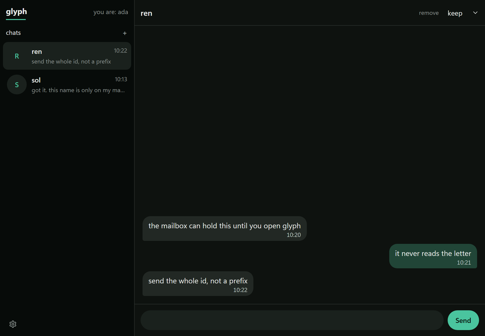

# glyph

glyph is a window for two people who already have each other's glyph ID. The ID is the public half of a key made on that machine. It is not registered anywhere. A short prefix of it is not an address.

The app is peer to peer over the internet. One machine listens, and the other dials it. The host and port are only where the connection goes. The glyph ID is who is on the other end. TLS 1.3 is pinned to that ID, and the letter is sealed to it. A person who was not added cannot connect. An address learned from the network is never dialed.

The mailbox is the only part that stays on the LAN. The window does not need it to send.



## Build

Go 1.26. Check out [glyph-mailbox](https://github.com/01wrx/glyph-mailbox) in the directory next to this one. The module file points at that sibling.

```powershell
go build -o glyph.exe ./cmd/glyph
.\glyph.exe
```

`glyph.exe` is a Windows program. Mac users download `glyph-macos.zip` from the releases page, unzip it, and run `./glyph`. That binary runs on Apple silicon and Intel. It opens in the browser.

The key, transcripts, and preferences live under `%AppData%\glyph`. `GLYPH_HOME` chooses another directory.

## Window

**you are** is the name on this machine. Clicking it copies the full glyph ID.

**+** takes a glyph ID you were given, and the host:port where that app can be reached. The whole ID is required. A letter is sealed to that ID and handed directly to that app. Settings shows the port this app is listening on. Give the other person your public host and that port.

The open chat shows letters in counter order, one sequence per sender. The time on a letter is the sender's clock, shown for reading. The app holds a letter until the next counter arrives.

**remove** stops accepting that glyph ID. The transcript on this machine stays. **keep** is how long this machine retains the letters: until you change it, 1 day, 7 days, 30 days, or off.

Settings holds the display name, the full glyph ID, this machine's private LAN address, and the theme.

## Identity

A glyph ID is `glyph:` plus 64 lowercase hex characters, the canonical Ed25519 public key. Share the whole ID by hand.

The ID changes only inside a conversation that already exists. This app seals one letter to that friend: the next ID, signed by the next key. Their app keeps the transcript and follows the new ID after they accept it. Anyone outside that conversation still cannot find either ID. A letter that is never sent leaves the new ID as a separate person.

A display name is a private label on this machine. It is never an address and never a way to search.

## Letters

A letter is signed by the sender and sealed to the recipient's glyph ID. It is carried over a connection that both sides pin to those keys. The letter is not stored on a server.

## Mailbox

The window delivers letters over the internet. It does not use a mailbox. The mailbox is the only glyph program that refuses a public address.

[glyph-mailbox](https://github.com/01wrx/glyph-mailbox) is a separate LAN box for sealed letters. It is not required to send. glyph can still run that box:

```powershell
.\glyph.exe mailbox -dir C:\mailbox-data -owner glyph:... -addr 192.168.1.20:7420
```

The address is a private, loopback, or link-local IP. `-owner` is a public glyph ID. The mailbox process is not given the private key.
